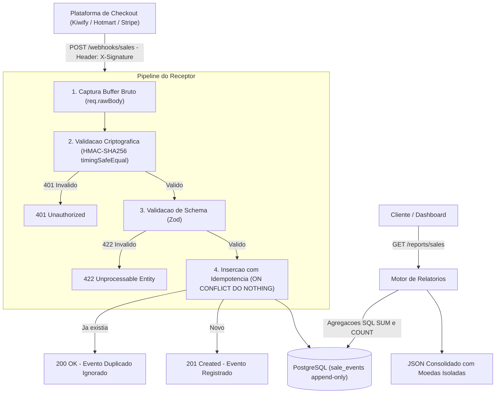

# Desafio TWR: Receptor de Postbacks & Relatório de Vendas

Aplicação de alta performance em **TypeScript** e **Fastify** para recepção de webhooks de plataformas de checkout (Kiwify, Hotmart, Stripe, etc.) com garantia estrita de **idempotência**, **validação de assinatura criptográfica HMAC-SHA256 sobre o raw body**, **tolerância a eventos fora de ordem** e **relatório analítico consolidado de vendas**.

---

## URL Pública da Aplicação

A aplicação está publicada no **Render** (Web Service com Docker + PostgreSQL gerenciado):

| Recurso | URL |
| :--- | :--- |
| **Base URL** | https://twr-postbacks-v8wu.onrender.com |
| **Health Check** | [`GET /health`](https://twr-postbacks-v8wu.onrender.com/health) |
| **Receptor de Webhooks** | `POST https://twr-postbacks-v8wu.onrender.com/webhooks/sales` |
| **Relatório de Vendas** | [`GET /reports/sales`](https://twr-postbacks-v8wu.onrender.com/reports/sales) |
| **Métricas (Prometheus)** | [`GET /metrics`](https://twr-postbacks-v8wu.onrender.com/metrics) |

> **Atenção:** o serviço roda no plano gratuito do Render, que hiberna após ~15 minutos sem tráfego. A **primeira requisição** depois disso pode levar de 30 a 60 segundos (cold start); as seguintes respondem normalmente.

Teste rápido:
```bash
curl https://twr-postbacks-v8wu.onrender.com/health
```
Resposta esperada:
```json
{ "status": "ok", "uptime": 13.66, "database": "connected", "timestamp": "2026-10-27T15:10:04.861Z" }
```

### Deploy (Render)
- **Build:** a partir do `Dockerfile` do repositório (multi-stage, `node:22-alpine`).
- **Banco:** PostgreSQL gerenciado do Render, injetado via variável `DATABASE_URL`.
- **Variáveis de ambiente:** `DATABASE_URL`, `WEBHOOK_SECRET` e `NODE_ENV=production` (o `PORT` é definido pelo próprio Render). Para facilitar a avaliação, o `WEBHOOK_SECRET` de produção é o mesmo do ambiente local (`twr_webhook_secret_key_2026`), então os exemplos de assinatura deste README e a coleção Postman funcionam tanto em `localhost` quanto na URL pública.
- **Migrações:** executadas automaticamente na inicialização do servidor (`runMigrations()` em `src/server.ts`), de forma idempotente (`CREATE TABLE IF NOT EXISTS`).
- **Tracing:** o container sobe com `node --import ./dist/observability/tracing.js dist/server.js`. Sem a variável `OTEL_EXPORTER_OTLP_ENDPOINT` o tracing fica desligado e nenhum pacote do OpenTelemetry é carregado (veja [Observabilidade](#observabilidade)).

---

## Stack Tecnológica

| Camada | Tecnologia | Motivação |
| :--- | :--- | :--- |
| **Linguagem** | **TypeScript 5 (Strict Mode)** | Tipagem estática, segurança em tempo de compilação e manutenibilidade. |
| **Runtime** | **Node.js 22+** | Suporte a ES Modules nativos e alta velocidade de I/O assíncrono. |
| **Framework HTTP** | **Fastify** | Alta performance, overhead mínimo e suporte nativo a manipulação de buffer bruto (*raw body*). |
| **Validação** | **Zod** | Validação em runtime de payloads e query params com inferência de tipos estáticos. |
| **Banco de Dados** | **PostgreSQL** (`pg` pool) | Transacional (ACID), constraints de unicidade para concorrência e agregações analíticas de alta velocidade. |
| **Testes** | **Vitest** | Suíte de testes automatizados ultrarrápida com cobertura dos cenários críticos de checkout. |
| **Observabilidade** | **Prometheus (`prom-client`) + OpenTelemetry** | Métricas em `/metrics`, traces distribuídos (HTTP + PostgreSQL) e `trace_id` nos logs. |
| **Containers** | **Docker & Docker Compose** | Reprodutibilidade de ambiente local e prontidão para deploy. |

---

## Arquitetura do Sistema



---

## Como Executar Localmente

### Pré-requisitos
- Node.js 22 ou superior instalado
- Docker & Docker Compose (opcional para rodar o PostgreSQL local)

### 1. Clonar e Instalar Dependências
```bash
git clone https://github.com/JoaoPedroDutraCoutinho/twr-postbacks.git
cd twr-postbacks
npm install
```

### 2. Configurar Variáveis de Ambiente
Copie o arquivo de exemplo:
```bash
cp .env.example .env
```
Variáveis disponíveis no `.env`:
- `PORT`: Porta do servidor (padrão: `3000`)
- `NODE_ENV`: `development` | `test` | `production`
- `DATABASE_URL`: String de conexão PostgreSQL
- `WEBHOOK_SECRET`: Chave secreta compartilhada para cálculo do HMAC (`twr_webhook_secret_key_2026`)
- `OTEL_EXPORTER_OTLP_ENDPOINT` *(opcional)*: liga o tracing OpenTelemetry e envia os traces para esse coletor (ex: `http://localhost:4318`)
- `OTEL_SERVICE_NAME` *(opcional)*: nome do serviço nos traces (padrão: `twr-postbacks`)

### 3. Subir o Banco de Dados e o Jaeger (via Docker)
```bash
docker compose up -d
```
Sobe o PostgreSQL (porta `5432`) e o Jaeger para visualizar traces (UI em `http://localhost:16686`).

### 4. Executar Migrações do Banco
```bash
npm run db:migrate
```

### 5. Iniciar a Aplicação
```bash
# Modo desenvolvimento com hot-reload (tsx)
npm run dev

# Ou Build e Start de produção
npm run build
npm start
```

---

## Bateria de Testes Automatizados

O projeto conta com uma suíte de testes em **Vitest** que exercita a aplicação inteira (rotas, assinatura, validação e relatório) via `app.inject`, cobrindo os cenários mais complexos de sistemas orientados a eventos:

```bash
npm test
```

> **Sobre o banco nos testes:** para a suíte rodar em menos de 1 segundo e sem Docker, os testes usam uma implementação em memória do repositório (`src/db/memory.ts`) que replica a regra de unicidade `(platform, event_id)`. A garantia de concorrência no **PostgreSQL real** vem da constraint `UNIQUE` + `ON CONFLICT DO NOTHING` e pode ser verificada com o simulador (`npm run simulate`), que dispara uma rajada concorrente contra o banco de verdade.

### Os 6 Casos Core Testados:
1. **Evento duplicado**: Retorna HTTP 200 e conta apenas 1 venda no relatório financeiro.
2. **20 envios concorrentes em paralelo**: Disparo simultâneo (`Promise.all`) de 20 requisições idênticas; exatamente 1 resulta em 201 e 19 em 200, validando o contrato de idempotência sob envios paralelos.
3. **Reembolso fora de ordem**: Um evento de `sale.refunded` recebido antes da aprovação produz o mesmo resultado determinístico de faturamento líquido (`net_cents = 0`).
4. **Payload inválido**: Payloads com campos faltantes, valores negativos ou JSON quebrado retornam HTTP 422 com detalhamento Zod.
5. **Assinatura adulterada**: Header `X-Signature` incorreto ou ausente retorna HTTP 401 sem processar a requisição.
6. **Isolamento de moedas**: Transações em `BRL` e `USD` são totalizadas em buckets próprios sem se misturar.

Testes adicionais cobrem o `/health`, o agrupamento `group_by=product` e as **métricas** (`/metrics` contando webhooks `created`, `duplicate` e `unauthorized`).

---

## Observabilidade

### Métricas (`GET /metrics`)
Endpoint no formato **Prometheus**, pronto para ser coletado por Prometheus, Grafana Agent ou Datadog:

| Métrica | Tipo | O que mostra |
| :--- | :--- | :--- |
| `twr_webhooks_received_total{result}` | Counter | Webhooks recebidos por resultado: `created`, `duplicate`, `unauthorized`, `invalid`, `rate_limited`, `error`. |
| `twr_http_request_duration_seconds{method,route,status_code}` | Histogram | Latência por rota (permite calcular p95/p99). |
| `twr_db_pool_connections{state}` | Gauge | Conexões do pool do PostgreSQL (`total`, `idle`, `waiting`). |
| `process_*`, `nodejs_*` | Diversos | CPU, memória, event loop lag e GC do Node.js. |

Exemplos de uso: alertar quando `rate(twr_webhooks_received_total{result="unauthorized"}[5m])` subir (alguém forjando assinaturas) ou quando `duplicate` disparar (plataforma em loop de retentativas).

### Traces distribuídos (OpenTelemetry)
Com a variável `OTEL_EXPORTER_OTLP_ENDPOINT` definida, cada requisição gera um trace com:
- span HTTP nomeado pela rota (ex: `POST /webhooks/sales`), com os atributos `webhook.platform`, `webhook.event_id`, `webhook.event_type` e `webhook.duplicate`, o que permite responder na hora "o evento X chegou? foi duplicado?";
- spans filhos das queries no PostgreSQL (`pg.query:INSERT ...`, `pg-pool.connect`);
- o `trace_id` injetado em cada linha de log e devolvido no header `x-trace-id`, ligando logs e traces.

Para ver localmente no Jaeger (no lugar da variável na linha de comando, dá para descomentar `OTEL_EXPORTER_OTLP_ENDPOINT` no `.env`):
```bash
docker compose up -d
OTEL_EXPORTER_OTLP_ENDPOINT=http://localhost:4318 npm run dev
npm run simulate
```
Depois abra `http://localhost:16686` e selecione o serviço `twr-postbacks`.

A configuração fica em `src/observability/tracing.ts`, carregado via `node --import` antes da aplicação (requisito para instrumentar módulos ESM). Sem a variável, o tracing fica desligado e nenhum pacote do OpenTelemetry é carregado. `/health` e `/metrics` são ignorados para não poluir os traces.

---

## Simulador de Plataforma de Checkout (`npm run simulate`)

Para demonstrar a robustez em tempo real em menos de 10 segundos, criamos um simulador executável que dispara um fluxo realista de vendas:

```bash
npm run simulate
```

O script:
- Dispara vendas legítimas em `BRL` e `USD`;
- Simula retentativas de rede (duplicatas da plataforma);
- Dispara uma rajada concorrente de 10 requisições para a mesma transação;
- Inverte a ordem de eventos (reembolso antes da aprovação);
- Tenta forçar payloads malformados e assinaturas forjadas;
- Consulta o endpoint de relatório e imprime a **reconciliação financeira exata**.

Para rodar o simulador contra a aplicação **em produção**, basta apontar a variável `API_URL`:
```bash
API_URL=https://twr-postbacks-v8wu.onrender.com npm run simulate
```

---

## Como Chamar a Aplicação (Exemplos Práticos)

> Os exemplos abaixo usam `http://localhost:3000`. Para chamar a aplicação em produção, troque pela Base URL `https://twr-postbacks-v8wu.onrender.com`.

### 1. POST do Webhook (`POST /webhooks/sales`)

O webhook exige o cabeçalho `X-Signature` com o HMAC-SHA256 do corpo bruto.

#### Gerando a Assinatura (Node.js em 1 linha):
```bash
node -e "const c=require('crypto'); console.log(c.createHmac('sha256','twr_webhook_secret_key_2026').update('{\"platform\":\"kiwify\",\"event_id\":\"evt_demo_101\",\"event_type\":\"sale.approved\",\"order_id\":\"ord_101\",\"product\":{\"id\":\"p1\",\"name\":\"Curso TWR\"},\"currency\":\"BRL\",\"amount_cents\":19700,\"customer\":{\"email\":\"aluno@twr.com\"}}').digest('hex'))"
```

#### Exemplo de Chamada `curl` (Venda Aprovada):
```bash
curl -X POST http://localhost:3000/webhooks/sales \
  -H "Content-Type: application/json" \
  -H "X-Signature: 664988e0bce62cb6eeb41dd368a44b9cb7eb2e3fc7bdf3a2fbddaaeb4185d0d1" \
  -d '{
    "platform": "kiwify",
    "event_id": "evt_demo_101",
    "event_type": "sale.approved",
    "order_id": "ord_101",
    "product": {
      "id": "p1",
      "name": "Curso TWR"
    },
    "currency": "BRL",
    "amount_cents": 19700,
    "customer": {
      "email": "aluno@twr.com",
      "name": "Maria Silva"
    }
  }'
```

**Resposta de Sucesso (Primeiro envio - HTTP 201):**
```json
{
  "statusCode": 201,
  "status": "created",
  "message": "Evento processado e registrado com sucesso",
  "eventId": "evt_demo_101",
  "id": "1"
}
```

**Resposta de Idempotência (Reenvio idêntico - HTTP 200):**
```json
{
  "statusCode": 200,
  "status": "duplicate",
  "message": "Evento duplicado detectado. Nenhuma ação duplicada realizada.",
  "eventId": "evt_demo_101"
}
```

---

### 2. GET do Relatório de Vendas (`GET /reports/sales`)

#### Exemplo 1: Relatório Consolidado Geral (Últimos 30 dias padrão)
```bash
curl -X GET http://localhost:3000/reports/sales
```

**Exemplo de Resposta:**
```json
{
  "period": {
    "from": "2026-09-23T14:00:00.000Z",
    "to": "2026-10-23T14:00:00.000Z",
    "timezone": "UTC"
  },
  "currencies": [
    {
      "currency": "BRL",
      "gross_cents": 19700,
      "refunded_cents": 0,
      "net_cents": 19700,
      "sales_count": 1,
      "refunds_count": 0
    }
  ]
}
```

#### Exemplo 2: Relatório Agrupado por Produto com Filtro de Data
```bash
curl -X GET "http://localhost:3000/reports/sales?from=2026-10-01T00:00:00Z&to=2026-10-31T23:59:59Z&group_by=product"
```

**Exemplo de Resposta:**
```json
{
  "period": {
    "from": "2026-10-01T00:00:00.000Z",
    "to": "2026-10-31T23:59:59.000Z",
    "timezone": "UTC"
  },
  "group_by": "product",
  "currencies": [
    {
      "currency": "BRL",
      "gross_cents": 19700,
      "refunded_cents": 0,
      "net_cents": 19700,
      "sales_count": 1,
      "refunds_count": 0
    }
  ],
  "groups": [
    {
      "group_key": "p1",
      "group_name": "Curso TWR",
      "currency": "BRL",
      "gross_cents": 19700,
      "refunded_cents": 0,
      "net_cents": 19700,
      "sales_count": 1,
      "refunds_count": 0
    }
  ]
}
```

---

## Coleção Postman

No diretório `postman/` do repositório você encontra:
- `twr_postbacks_collection.json`: Coleção contendo testes automatizados para todas as rotas e **Pre-request Script dinâmico que calcula o HMAC-SHA256 automaticamente** usando `CryptoJS`.
- `twr_local.postman_environment.json`: Variáveis para ambiente local (`http://localhost:3000`).
- `twr_production.postman_environment.json`: Variáveis para o ambiente em produção (`https://twr-postbacks-v8wu.onrender.com`).

Para usar: importe a coleção e os dois environments no Postman, selecione o environment desejado (**TWR Localhost** ou **TWR Production**) e execute a coleção pelo *Collection Runner*.

---

## Premissas e Decisões de Engenharia

### 1. Idempotência no Nível do Banco (`ON CONFLICT DO NOTHING`)
- **Problema real:** Plataformas de pagamento implementam retentativas agressivas quando encontram oscilações de rede. Se duas requisições idênticas atingirem o receptor simultaneamente, uma verificação em memória ou um simples `SELECT` prévio sofreriam de *race condition*.
- **Decisão:** Criamos uma restrição única composta no banco `UNIQUE (platform, event_id)` e utilizamos `INSERT ... ON CONFLICT (platform, event_id) DO NOTHING RETURNING id`. Se a linha não for inserida, respondemos imediatamente `200 OK`, sinalizando que a notificação já foi processada e interrompendo o ciclo de retentativas.

### 2. Validação HMAC-SHA256 sobre o *Raw Body*
- **Problema real:** Quase todos os bugs de integração de webhooks decorrem de calcular o hash sobre o objeto JSON já parseado. Quando o Node converte JSON em objeto e depois faz `JSON.stringify()`, espaçamentos, escapes e a ordem das chaves mudam, quebrando o hash criptográfico.
- **Decisão:** Customizamos o parser de `application/json` do Fastify para reter o `Buffer` original exato antes de decodificar. A verificação utiliza `crypto.timingSafeEqual` para blindar o serviço contra ataques de canal lateral (*timing attacks*).

### 3. Log de Eventos Imutável (*Append-Only*)
- **Problema real:** Em cenários assíncronos, mensagens podem chegar fora de ordem (ex: o evento de estorno/reembolso ser processado antes do evento de aprovação).
- **Decisão:** Adotamos um modelo *append-only*. Não sobrepomos registros nem dependemos de locks pesados de linha. O relatório calcula o faturamento líquido (`net_cents = gross_cents - refunded_cents`) a partir dos eventos gravados, gerando sempre o mesmo resultado determinístico, independentemente da ordem de chegada.

### 4. Valores Monetários em Centavos Inteiros (`amount_cents`)
- **Decisão:** Nenhum valor monetário é manipulado como ponto flutuante (`float`/`double`), eliminando os clássicos erros de arredondamento da norma IEEE 754.

### 5. Isolamento Estrito de Moedas
- **Decisão:** Não existe conversão cambial implícita no backend. R$ 100,00 e $ 100,00 USD são totalizados em registros independentes na chave `currencies`.

### 6. Fuso Horário UTC Padronizado
- **Decisão:** Todos os agrupamentos diários (`group_by=day`) utilizam `DATE_TRUNC('day', event_created_at AT TIME ZONE 'UTC')`, evitando discrepâncias causadas pelo horário local do servidor.

---

## O que Decidimos NÃO Fazer (e Por Quê)

1. **Fila Distribuída (Kafka / RabbitMQ / SQS):**
   - *Por que não:* Para o escopo do desafio (tempo estimado de 3 a 4 horas), adicionar um broker de mensagens adicionaria complexidade operacional desnecessária (gerenciamento de acks, dead-letters externas, múltiplos containers). O PostgreSQL lida com dezenas de milhares de inserções por segundo com garantias transacionais ACID estritas.
   - *Como escalar:* Em um cenário real com picos acima de 50.000 requisições/segundo, o receptor Fastify apenas enfileiraria o payload bruto em um buffer assíncrono (ex: SQS ou Redis Streams) e workers gravariam no banco.

2. **Banco Analítico Dedicado (ClickHouse):**
   - *Por que não:* Índices btree compostos no PostgreSQL em `(event_type, currency, event_created_at)` atendem com folga as agregações do relatório no volume esperado para o desafio. Introduzir ClickHouse exigiria pipelines de CDC (Change Data Capture) como Debezium.
   - *Quando faria sentido:* com centenas de milhões de eventos e dashboards consultando em tempo real, o `sale_events` (que já é *append-only*) seria replicado para o ClickHouse e o relatório passaria a consultá-lo.

3. **GraphQL:**
   - *Por que não:* O enunciado solicita explicitamente a recepção por `POST` e relatório por `GET`. REST com HTTP Caching e query params oferece menor latência e padrão universal para webhooks.

---

## Limitações e Próximos Passos (Evolução Técnica)

- **Testes contra PostgreSQL real no CI:** rodar a mesma suíte também contra um PostgreSQL de verdade (GitHub Actions com container de serviço), validando a concorrência diretamente no banco.
- **Processamento assíncrono:** gravar o payload bruto e responder imediatamente, deixando um worker processar os eventos a partir de uma fila no próprio PostgreSQL (`SELECT ... FOR UPDATE SKIP LOCKED`), com retentativas.
- **Dead-Letter Queue interna:** Mecanismo para armazenar eventos que falharam na validação para posterior auditoria/reprocessamento.
- **Rotação de Segredos:** Suporte a múltiplos segredos simultâneos para permitir rotação de chaves sem downtime.

---

## Transparência sobre Ferramentas

Conforme as melhores práticas da engenharia moderna e os conselhos do time da TWR, este projeto foi planejado arquiteturalmente e implementado com o auxílio de inteligência artificial (Google Antigravity), tendo **cada linha de código, teste automatizado, tipagem e decisão de engenharia minuciosamente revisada, validada e compreendida**.
